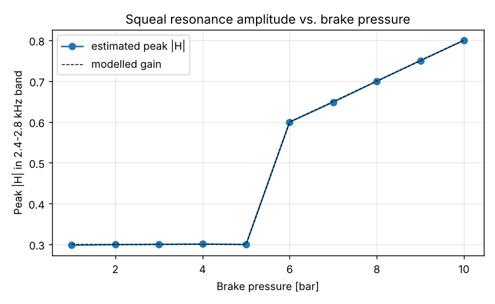
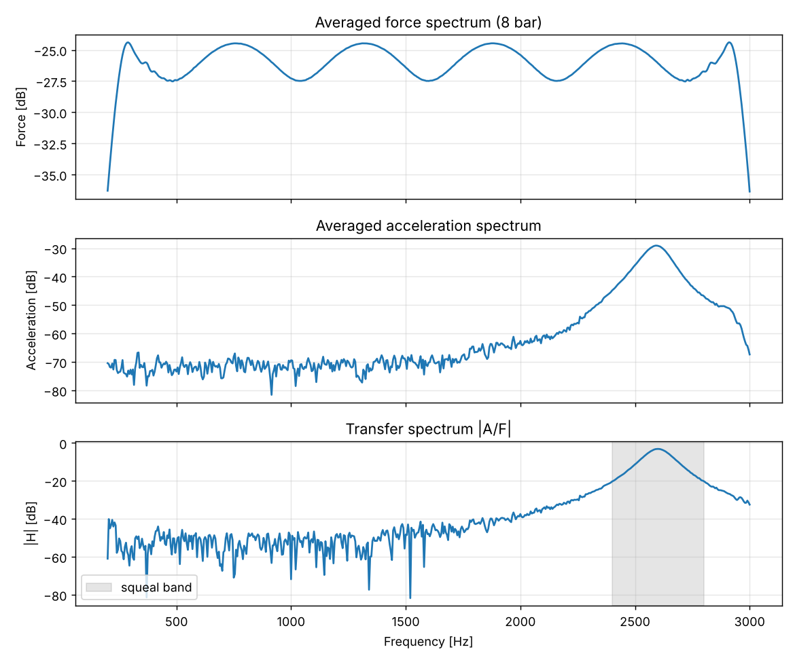
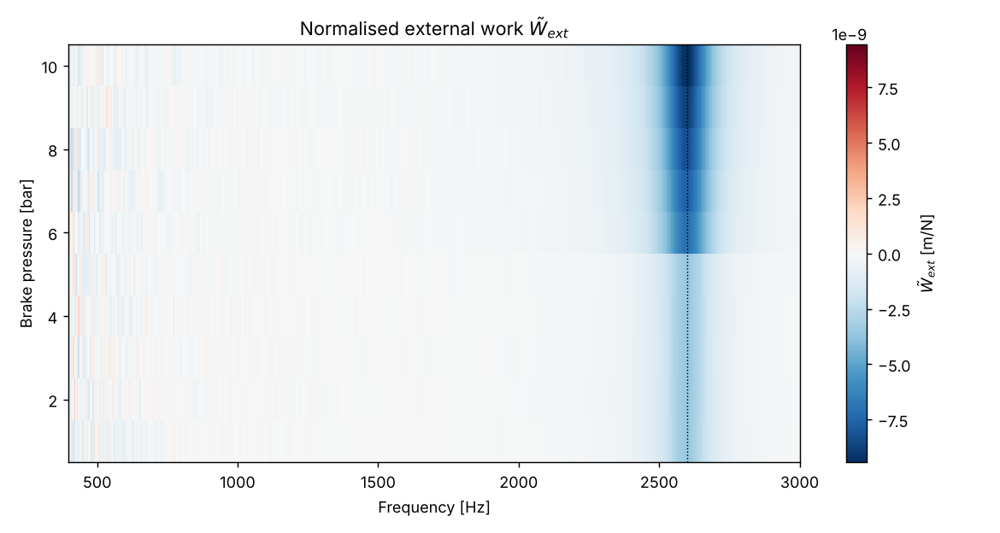

# Brake Squeal Analysis

A Jupyter notebook for the spectral analysis of brake squeal: transfer-function estimation from force and acceleration signals and detection of the squeal resonance as a function of brake pressure.

The project is based on my master's thesis at TU Berlin (2019, written at BMW Group):

> "Entwicklung und Erprobung einer Messmethodik zur Untersuchung der Quietschanfälligkeit von KFZ-Scheibenbremsen mittels piezoelektrischer Anregung im Bremskolben"
> (Development and testing of a measurement method for investigating the squeal propensity of automotive disc brakes using piezoelectric excitation in the brake piston)

**Data:** the notebook works with **synthetic data** from a simple transfer-function model. No measurement data from the thesis are included. The goal is a reproducible, automated version of the signal-processing chain, not a physical brake model.

## Quick start

```bash
pip install -r requirements.txt
jupyter notebook analyze.ipynb
```

Then run all cells (`Kernel → Restart & Run All`). Everything, from data generation to plots, is in [`analyze.ipynb`](analyze.ipynb). It runs in a few seconds. The notebook is stored with its outputs, so GitHub shows the results without running anything.

## Results

The analysis recovers the modelled squeal resonance at 2.6 kHz and its dependence on brake pressure.

| Brake pressure | Peak frequency | Peak amplitude \|H\| |
|---|---|---|
| 1-5 bar | 2595-2600 Hz | about 0.30 |
| 6 bar | 2595 Hz | 0.60 |
| 8 bar | 2600 Hz | 0.70 |
| 10 bar | 2600 Hz | 0.80 |

In the model the resonance exists at every pressure and its gain jumps from 0.3 to 0.6 above 5 bar, then grows with pressure. The estimated amplitudes reproduce the modelled gain within 1 %, and the peak frequency is found within one frequency bin (5 Hz) of the modelled 2600 Hz.



The transfer spectrum at 8 bar shows the resonance inside the search band (2.4-2.8 kHz):



The normalised external work over frequency and pressure shows the squeal feature at 2.6 kHz, pronounced from 6 bar upwards:



## Method

For each pressure the notebook

1. simulates a repeated linear sweep (200-3000 Hz) as force and the resulting acceleration (44.1 kHz, 1 s, white noise on both channels),
2. splits force and acceleration into 5 blocks and computes Hann-windowed FFTs (amplitude-corrected),
3. estimates the transfer function with the H1 estimator, which is robust against noise on the acceleration channel:

$$H(f) = \frac{\langle A \, F^{*} \rangle}{\langle F \, F^{*} \rangle}$$

4. computes the normalised external work from magnitude and phase of H:

$$\tilde{W}_{ext} = \frac{\pi}{\Omega^{2}} \, |H| \, \sin(\alpha), \qquad \alpha = \arg H, \quad \Omega = 2\pi f$$

5. searches the squeal band (2.4-2.8 kHz) for the strongest peak of |H|.

The analysis band (200-3000 Hz) equals the sweep band of the excitation, because outside it the force spectrum carries almost no energy and H is not defined.

## Self-check

The data are synthetic, so the correct answer is known. A test cell in the notebook asserts that

- the squeal peak is found within 10 Hz of 2.6 kHz at every pressure,
- the peak amplitude matches the modelled gain within 2 %,
- the amplitude steps up when the pressure crosses 5 bar.

If a cell fails after you change a parameter or the analysis, the assertion message names the pressure and the deviation.

## Repository structure

```
analyze.ipynb                    data generation, analysis, self-check and plots
requirements.txt                 numpy, matplotlib, notebook
figure_peak_vs_pressure.png      result figures (written by the notebook)
figure_spectra.png
figure_work_map.png
```

Set `WRITE_CSV = True` in the parameter cell to also export the synthetic data as `data/measurement_XXbar.csv` (columns `time_s`, `force_N`, `accel_m_s2`).

## Limitations

- The squeal resonance and its pressure dependence are prescribed by the model, so the notebook validates the signal-processing chain, not a physical brake.
- Real measurements are longer (31 s in the thesis) and include temperature and speed effects that are not modelled here.
- The frequency resolution is 5 Hz (5 blocks of 0.2 s).
- To analyse real data, replace the dictionary `measurements` in section 2 by `{pressure: (time, force, acceleration)}` from your own files. The self-check only applies to the synthetic data.

## Author

Mohammed Omar Faruqe Rashell
